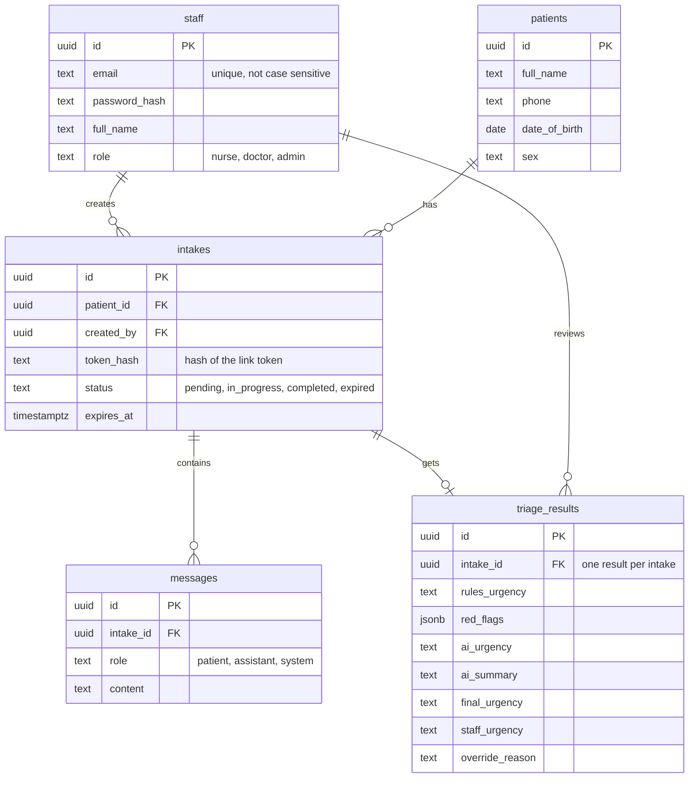

# Database schema

Five tables, plus `schema_migrations` (created by the migration runner).

## Notes

- **Urgency** is one of `emergency`, `urgent`, `routine`.
- `final_urgency` is the higher of `rules_urgency` and `ai_urgency`. If the AI fails, `ai_urgency` stays empty and the case moves up, not down.
- A staff override needs a reason. The database enforces this with a check.
- Link tokens are stored as a hash. The real token is only shown once, when staff create the link.
- Deleting an intake also deletes its messages and triage result.
- Migrations are plain SQL files in `backend/internal/db/migrations/`. They run in name order when the server starts.
